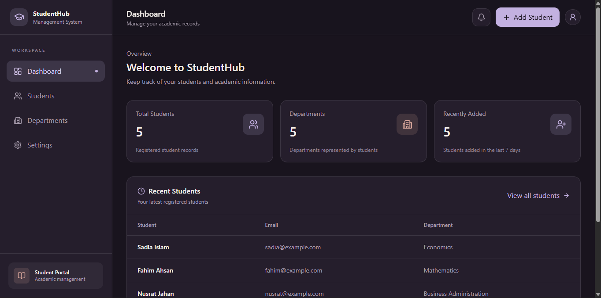
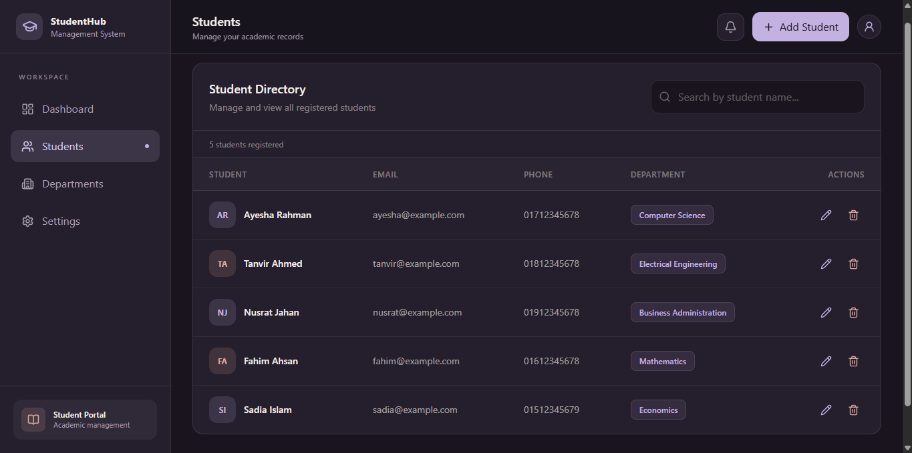
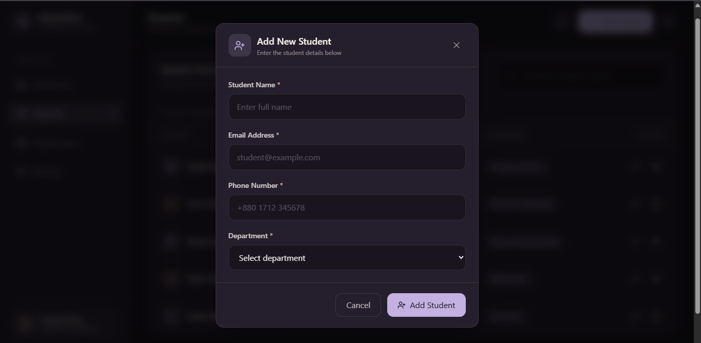
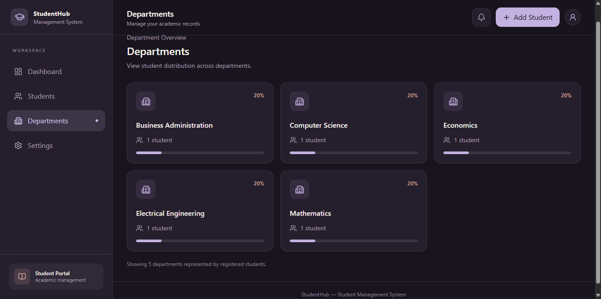
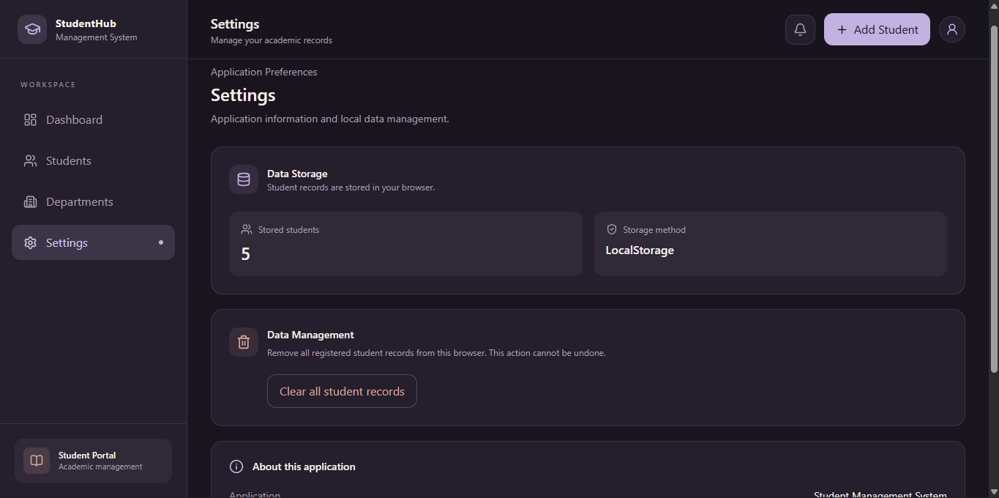

# Student Management System

A responsive student management application built with React, Redux Toolkit, and Tailwind CSS. It provides an organized interface for managing student records, tracking departments, and viewing recent student activity.

## Live Demo

[View Live Application](ADD_YOUR_DEPLOYED_URL_HERE)

## Preview

### Dashboard


### Student Directory


### Add Student


### Departments


### Settings


## Features

- Add new students with name, email, phone number, and department.
- View student records in an organized table.
- Edit existing student information.
- Delete student records with confirmation.
- Search students by name.
- Validate required fields and input formats.
- Prevent duplicate email addresses.
- Display total student and department statistics.
- View recently added students on the dashboard.
- View department-wise student counts.
- Track recent student activity through notifications.
- Persist student records using browser LocalStorage.
- Clear all student records with confirmation.
- Responsive layout for desktop, tablet, and mobile devices.

## Technologies Used

| Technology | Purpose |
|---|---|
| React | Component-based user interface |
| Vite | Development server and build tool |
| Redux Toolkit | Application state management |
| React Redux | Connecting React components to Redux |
| Tailwind CSS | Responsive styling |
| Lucide React | Icons |
| React Toastify | Toast notifications |
| JavaScript | Application logic |
| LocalStorage | Persistent student data |

## Project Structure

```text
student-management-system/
├── public/
├── docs/
│   └── screenshots/
├── src/
│   ├── app/
│   │   └── store.js
│   ├── components/
│   │   ├── layout/
│   │   │   ├── Header.jsx
│   │   │   ├── Sidebar.jsx
│   │   │   └── SettingsPanel.jsx
│   │   └── ui/
│   │       └── ConfirmDialog.jsx
│   ├── features/
│   │   └── students/
│   │       ├── components/
│   │       │   ├── DepartmentOverview.jsx
│   │       │   ├── StudentForm.jsx
│   │       │   └── StudentTable.jsx
│   │       └── studentsSlice.js
│   ├── utils/
│   │   ├── storage.js
│   │   └── validation.js
│   ├── App.jsx
│   ├── index.css
│   └── main.jsx
├── .gitignore
├── index.html
├── package.json
├── package-lock.json
└── vite.config.js
```

## Getting Started

### Prerequisites

- Node.js (LTS version recommended)
- npm
- Git

### Installation

1. Clone the repository:

   ```bash
   git clone https://github.com/malihamohit1100/student-management-system
   ```

2. Navigate to the project directory:

   ```bash
   cd student-management-system
   ```

3. Install dependencies:

   ```bash
   npm install
   ```

4. Start the development server:

   ```bash
   npm run dev
   ```

5. Open the local URL displayed in your terminal.

### Production Build

To create a production build:

```bash
npm run build
```

To preview the production build locally:

```bash
npm run preview
```

## State Management

Redux Toolkit manages the student data and application state.

The student slice includes actions for:

- Adding students
- Editing students
- Deleting students
- Searching students
- Clearing all student records
- Tracking recent student activity

## Data Persistence

Student records are stored in the browser's LocalStorage. This allows the application to retain student information after a page refresh.

The application does not currently use a backend server or database. Data is stored locally in the browser where the application is accessed.

Recent activity notifications are maintained in the current Redux session and are not persisted across page refreshes.

## Design

The application uses a dark visual theme with deep twilight backgrounds, smoky plum surfaces, pastel lavender accents, and soft terracotta highlights.

The interface is designed to provide a clear dashboard, accessible navigation, and responsive student management experience.

## Author

**Maliha Mohit**

[GitHub](https://github.com/malihamohit1100)
[LinkedIn](https://www.linkedin.com/in/maliha-mohit-1a0b4b1b2/)
